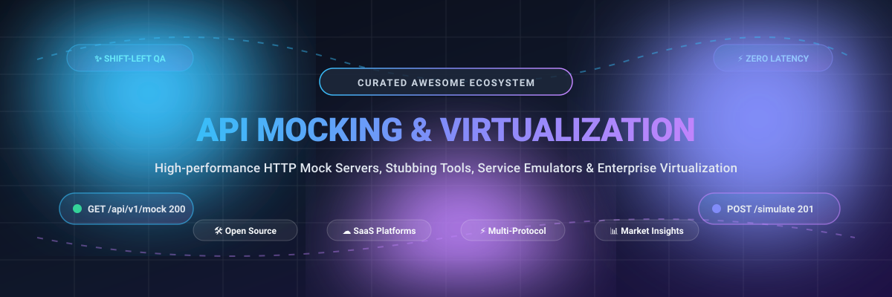

  

# 🚀 Awesome API Mocking & Service Virtualization

> A comprehensive, SEO-optimized, and curated directory of top-tier **API Mocking**, **Service Virtualization**, **HTTP Stubbing**, and **Contract Testing** solutions across Open-Source ecosystems and Enterprise SaaS platforms.

  <a href="#-table-of-contents">📑 Table of Contents</a> •
  <a href="#-sector-overview--market-dynamics">📈 Sector Overview</a> •
  <a href="#-saas--commercial-platforms">☁️ SaaS Platforms</a> •
  <a href="#-open-source-mocking--virtualization-engines">🛠️ Open-Source Engines</a> •
  <a href="#-star-history">⭐ Star History</a> •
  <a href="#-support--contributing">🤝 Support</a>

---

## 📑 Table of Contents

- [📈 Sector Overview & Market Dynamics](#-sector-overview--market-dynamics)
- [☁️ SaaS & Commercial Platforms](#-saas--commercial-platforms)
- [🛠️ Open-Source Mocking & Virtualization Engines](#-open-source-mocking--virtualization-engines)
- [🎯 Choosing the Right Tool: Decision Matrix](#-choosing-the-right-tool-decision-matrix)
- [⭐ Star History](#-star-history)
- [🤝 Support & Sponsoring](#-support--sponsoring)
- [📜 License](#-license)

---

## 📈 Sector Overview & Market Dynamics

The dedicated API mocking software market is valued at approximately **$100M+**, while the broader service virtualization market stands at **~$1.1B** (projected to reach **$2.27B by 2030** at ~17.4% CAGR). The market exhibits **moderate fragmentation with tiered concentration**: enterprise service virtualization and full API lifecycle management are dominated by established incumbents (such as Postman and SmartBear), while developer-first mocking tools remain competitive and fragmented across specialized SaaS offerings and popular open-source engines.

---

## ☁️ SaaS & Commercial Platforms

| 🏷️ Product | 🏢 Company Size / Valuation | 💳 Starting Paid Tier Pricing | 🎁 Free Tier / Trial Limit | ✨ Key Features |
|---|---|---|---|---|
| **[Postman](https://www.postman.com/)** | **$5.6B Valuation** (~$313M+ ARR) | **$9/month** (Solo, billed annually) or **$19/user/month** (Team, billed annually) | **Forever Free**: Unlimited mock server calls; limited to 1 user seat | Complete API lifecycle platform, integrated workspace mock servers, Postbot AI, collection runners. |
| **[SmartBear ReadyAPI](https://smartbear.com/product/ready-api/api-virtualization/)** | **$1.8B–$2B Valuation** (~$150M+ ARR) | **$1,270/year** (Fixed / Named user license for Virtualization module) | **14-day Free Trial**: Full access to Pro features; no credit card required | Enterprise-grade multi-protocol service virtualization, automated assertions, CI/CD pipelines. |
| **[Apidog](https://apidog.com/)** | **Bootstrapped / Private** (Mid-tier SaaS, undisclosed valuation) | **$9/user/month** (Basic, billed annually at $108/user/year) | **Forever Free**: Up to 4 users, unlimited mock calls & test runs; limited project sprint branches | All-in-one API design, dynamic smart mocking based on JSON Schema/faker rules, automated testing. |
| **[Beeceptor](https://beeceptor.com/)** | **Bootstrapped / Private** (<$50M revenue, lean indie team) | **$10/month** (Individual tier) | **Forever Free**: 50 requests/day, 3 mock rules/endpoint, 50 JSON storage objects; public endpoints (unclaimed deleted after 30 days, claimed retained 90 days) | Zero-setup instant mock endpoints, request routing, HTTP inspection, webhook debugging, proxying. |
| **[Mockoon Pro](https://mockoon.com/)** | **Bootstrapped / Indie** (OSS-backed, minor accelerator grants) | **€10/license/month** (Team plan, billed annually at €120/license/yr; min. 5 licenses = €50/mo) | **14-day Free Trial** for Pro; *(Core Mockoon desktop/CLI application is 100% free & open source under MIT)* | Real-time team collaboration, remote self-hosted mock deployment via Docker, role-based access control. |

---

## 🛠️ Open-Source Mocking & Virtualization Engines

> Repositories are ranked and sorted in descending order by GitHub Stars_Counts. Every Stars_Badge links directly to the repository's live stargazers page.

| 📦 Project | ⭐ GitHub_Stars | 📜 License | 💡 Overview & Primary Capabilities |
|---|---|---|---|
| **[msw](https://github.com/mswjs/msw)** |  | MIT | Seamless client-side and server-side API mocking utilizing Service Worker API to intercept network requests at the transport layer without modifying application code. |
| **[nock](https://github.com/nock/nock)** |  | MIT | The definitive HTTP server mocking and expectations library for Node.js. Intercepts `http.ClientRequest` and supports strict assertion matching. |
| **[mockoon](https://github.com/mockoon/mockoon)** |  | MIT | Extremely quick, lightweight desktop GUI and headless CLI tool to configure and run local mock REST APIs in seconds with templating, proxy mode, and regex routes. |
| **[wiremock](https://github.com/wiremock/wiremock)** |  | Apache-2.0 | Battle-tested, enterprise-grade flexible HTTP/HTTPS stubbing engine with 5–6M monthly downloads; deploys as a standalone JAR, Docker container, or embedded Java server. |
| **[miragejs](https://github.com/miragejs/miragejs)** |  | MIT | Client-side API mocking library that simulates complete backend architectures with dynamic database ORM, relationships, and route handlers directly inside frontend apps. |
| **[prism](https://github.com/stoplightio/prism)** |  | Apache-2.0 | Turn any OpenAPI v2/v3 or Postman Collection specification into a responsive, schema-validating local mock server via a rapid CLI. |
| **[mountebank](https://github.com/bbyars/mountebank)** |  | MIT | Fully cross-platform multi-protocol service virtualization tool enabling stubbing and recording across HTTP, HTTPS, TCP, and SMTP protocols. |
| **[microcks](https://github.com/microcks/microcks)** |  | Apache-2.0 | CNCF incubating cloud-native service mocking and contract testing platform supporting REST, GraphQL, gRPC, and asynchronous event streams (Kafka, WebSocket). |

---

## 🎯 Choosing the Right Tool: Decision Matrix

- **Frontend Integration Testing (React, Vue, Svelte, Next.js):** Choose **[MSW](https://github.com/mswjs/msw)** or **[Mirage JS](https://github.com/miragejs/miragejs)** to intercept network traffic without mocking `fetch` / `axios` globally.
- **Node.js Unit & Integration Testing:** Choose **[Nock](https://github.com/nock/nock)** for deterministic, in-process HTTP mocking.
- **Microservices & Standalone Stubs:** Choose **[WireMock](https://github.com/wiremock/wiremock)** or **[Mockoon](https://github.com/mockoon/mockoon)** for battle-tested Docker containers or zero-config desktop workflows.
- **Contract & Spec-Driven Mocking:** Choose **[Stoplight Prism](https://github.com/stoplightio/prism)** for OpenAPI spec compliance or **[Microcks](https://github.com/microcks/microcks)** for multi-protocol contract tests.
- **Enterprise Service Emulation:** Choose **[SmartBear ReadyAPI](https://smartbear.com/product/ready-api/api-virtualization/)** for mission-critical enterprise virtualization or **[Mountebank](https://github.com/bbyars/mountebank)** for legacy non-HTTP protocols (TCP/SMTP).

---

## 📊 Star History

---

## 🤝 Support & Contributing

Thank you for visiting and supporting the **Awesome API Mocking & Service Virtualization** repository! 🙌

Whether you are building resilient microservices, shifting testing left, or setting up hermetic CI/CD pipelines, reliable mock servers and service virtualization make all the difference.

### 💖 Ways to Support:
- ⭐ **Star this repository** to help others discover it across GitHub and developer search engines!
- 🍴 **Fork and contribute** by submitting a Pull Request if you know of an awesome mocking tool, library, or platform that should be included.
- 📢 **Share** this collection with your engineering team, tech community, and on social media.
- ☕ **Buy a Coffee / Sponsor**: Support continued maintenance and curation via the [GitHub Sponsor Dashboard](https://github.com/sponsors/ishandutta2007).

---

## 📜 License

This project is licensed under the [MIT License](LICENSE).
